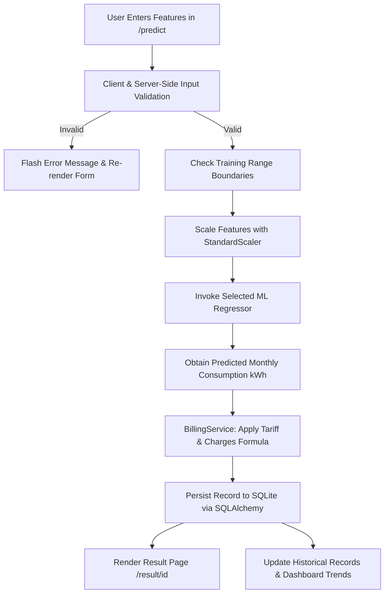

# PROJECT REPORT

---

## MCA MINOR PROJECT REPORT

### TITLE:
# ELECTRICITY BILL PREDICTION SYSTEM USING MACHINE LEARNING

**A Project Report Submitted in Partial Fulfillment of the Requirements for the Degree of**  
**MASTER OF COMPUTER APPLICATIONS (MCA)**

---

### Submitted By:
- **Student Name:** [Student Name Placeholder]
- **Roll Number:** [University Roll Number Placeholder]
- **Enrollment Number:** [Enrollment Number Placeholder]
- **Program:** Master of Computer Applications (MCA)
- **Semester:** Minor Project Semester

### Under the Supervision of:
- **Project Supervisor:** [Supervisor / Professor Name Placeholder]
- **Department:** Department of Computer Applications / Computer Science
- **Institution:** [College / University Name Placeholder]
- **Academic Year:** 2025 – 2026

---

## 2. ABSTRACT

Electricity consumption prediction and utility bill estimation play a pivotal role in consumer budgeting, energy efficiency, and demand-side management. Traditional electricity billing systems operate ex-post (after meter readings are taken at the end of a billing cycle), leaving consumers without proactive estimates or actionable awareness of their pending expenses. 

This minor project introduces the **Electricity Bill Prediction System Using Machine Learning**, an explainable and interactive web-based system developed using Python, Flask, Scikit-learn, SQLAlchemy, and SQLite. The application decouples physical energy consumption forecasting (measured in kilowatt-hours, kWh) from financial tariff policy. 

Two regression algorithms are implemented, trained, and comparatively evaluated:
1. **Linear Regression** (Ordinary Least Squares)
2. **Random Forest Regressor** (Ensemble of 100 Decision Trees)

On a reproducible demonstration dataset of 1,500 records evaluated on 300 held-out test samples (80/20 split), **Linear Regression** achieved superior predictive accuracy with a Mean Absolute Error (MAE) of **10.852 kWh**, Root Mean Squared Error (RMSE) of **13.660 kWh**, and an $R^2$ score of **0.9931**, compared to Random Forest Regressor (MAE: 11.960 kWh, RMSE: 15.107 kWh, $R^2$: 0.9916). 

The application incorporates transparent bill calculations, persistent prediction history in SQLite, automated input validation with out-of-distribution warnings, and an analytical dashboard powered by Chart.js. A test suite comprising 28 automated test cases was executed with 100% pass rate.

---

## 3. INTRODUCTION

Electricity powers modern domestic, commercial, and industrial activity. However, fluctuations in weather, varying appliance usage patterns, seasonal appliance loads (such as HVAC and cooling equipment), and variable billing cycle lengths make monthly electricity bills challenging for consumers to anticipate.

In academic computer applications, building predictive systems requires not only implementing machine learning algorithms, but also architecting robust, transparent, and user-centric software that can be audited and understood. This project integrates statistical regression models into a full-stack Flask web application, allowing users to enter recent consumption parameters, select machine learning models, inspect transparent tariff breakdowns, and monitor trends over time.

---

## 4. PROBLEM STATEMENT

Conventional electricity billing workflows present several challenges:
1. **Lack of Mid-Cycle Visibility:** Consumers only learn their electricity costs when physical or digital bills arrive at the conclusion of the billing cycle.
2. **Tariff Opacity:** Utility bills frequently conflate energy consumption with flat taxes, fixed charges, and variable surcharges without clear itemization.
3. **Rigid Tariff Assumptions in Typical ML Tools:** Many naive machine learning tools predict currency directly without considering that tariffs, fixed charges, and government duties change over time and across jurisdictions.
4. **Data Leakage and Black-Box Estimation:** Many student projects fit preprocessing transforms on entire datasets before splitting, leading to target leakage and artificially inflated, fabricated accuracy claims.

---

## 5. OBJECTIVES

The primary objectives of this MCA minor project are:
1. **Consumption-First Prediction Architecture:** Train machine learning models to forecast monthly consumption (kWh) based on average daily usage, historical consumption, and billing cycle days.
2. **Dual Model Comparison:** Implement both **Linear Regression** and **Random Forest Regressor**, and objectively evaluate both models using empirical regression metrics on an unseen test set.
3. **Fair Evaluation Without Leakage:** Fit all feature scaling transforms (`StandardScaler`) strictly on the training partition to maintain methodological rigor.
4. **Transparent Bill Breakdown:** Calculate the estimated electricity bill using transparent formulas:
   - Energy Charge = Predicted kWh &times; Tariff per kWh
   - Surcharges = Energy Charge &times; Surcharge %
   - Total Bill = Energy Charge + Fixed Charges + Surcharges
5. **Persistence & Auditing:** Persist user predictions in an embedded SQLite database using SQLAlchemy ORM.
6. **Visual Analytics:** Provide an interactive dashboard with Chart.js displaying historical billing trends, consumption tiers, and model comparisons.
7. **Comprehensive Automated Testing:** Validate software functionality, boundary conditions, and mathematical accuracy using Pytest.

---

## 6. EXISTING SYSTEM VS. PROPOSED SYSTEM

| Parameter | Existing System | Proposed System |
| :--- | :--- | :--- |
| **Billing Awareness** | Post-consumption only (after utility meter reader visits) | Proactive, instant estimation during or before the cycle |
| **Prediction Target** | Direct currency or crude rule of thumb ($kWh \times tariff$) | Machine learning forecasting with behavioral inertia & variance |
| **Model Transparency** | Black-box or single unverified formula | Empirical comparison of Linear Regression and Random Forest |
| **Preprocessing Rigor** | Ad-hoc or subject to data leakage | Strict fit on training split only; saved via joblib artifacts |
| **Data Storage** | Ephemeral or spreadsheet-based | Normalized SQLite database using SQLAlchemy ORM |
| **Out-of-Range Guard** | Absent (silent invalid extrapolation) | Explicit warning banners for out-of-distribution inputs |
| **Testing & Verification**| Manual testing only | Automated test suite (28 test cases) covering edges and routes |

---

## 7. FUNCTIONAL AND NON-FUNCTIONAL REQUIREMENTS

### Functional Requirements
1. **User Input Capture:** Accepts average daily consumption (kWh/day), previous month's usage (kWh), billing period (days), tariff rate (₹/kWh), fixed fees (₹), and additional surcharges (%).
2. **Input Validation:** Rejects negative inputs, zero daily consumption, invalid billing days ($\le 0$ or $> 365$), negative tariffs, missing fields, NaNs, and infinity.
3. **Preset Loading:** Provides one-click presets for small apartments, medium households, and commercial loads.
4. **Live Estimation Preview:** Computes immediate baseline approximations in real-time on the browser interface.
5. **Model Inference:** Supports automatic model selection (based on test set RMSE) or explicit user algorithm selection.
6. **Result Breakdown:** Shows itemized energy charges, fixed fees, surcharges, and usage tier (Low, Moderate, High).
7. **Historical Records:** Allows viewing, searching, filtering (by model and date range), and deleting stored predictions.
8. **Dashboard Analytics:** Calculates live statistics (total count, average bill, latest bill, average consumption) and renders Chart.js visualizations.
9. **Model Evaluation Page:** Displays test set MAE, RMSE, $R^2$, actual-versus-predicted sample curves, and educational definitions.

### Non-Functional Requirements
1. **Performance:** In-memory caching of serialized model artifacts ensures sub-50ms inference time per prediction request.
2. **Reliability:** SQLite database persists records across application and operating system restarts.
3. **Usability:** Responsive Bootstrap 5 interface accessible across desktop, tablet, and mobile browsers.
4. **Security & Integrity:** SQL injection prevention through SQLAlchemy parameterization; strict server-side validation.
5. **Portability:** Operates locally on Windows without requiring Docker, cloud services, or external database servers.

---

## 8. HARDWARE AND SOFTWARE REQUIREMENTS

### Hardware Requirements (Development & Execution)
- **Processor:** Intel Core i3 / AMD Ryzen 3 or higher (Tested on AMD Ryzen / Intel Core)
- **RAM:** Minimum 4 GB (8 GB recommended)
- **Storage:** 200 MB free hard disk space for code, virtual environment, and database
- **Display:** 1366 &times; 768 minimum resolution

### Software Requirements
- **Operating System:** Microsoft Windows 10 / 11 (PowerShell 5.1+)
- **Programming Language:** Python 3.10 to 3.13 (Tested on Python 3.13.0)
- **Web Framework:** Flask 3.1.3
- **ORM & Database:** SQLAlchemy 2.0.51 / Flask-SQLAlchemy 3.1.1 / SQLite 3
- **Machine Learning Libraries:** Scikit-learn 1.7.2, NumPy 2.3.3, Pandas 2.3.3, Joblib 1.5.2
- **Testing Framework:** Pytest 9.1.1
- **Frontend Technologies:** HTML5, CSS3, JavaScript (ES6), Bootstrap 5.3.3, Chart.js 4.4.1

---

## 9. SYSTEM ARCHITECTURE

The application follows an **n-tier Application Architecture**:

```
+-----------------------------------------------------------------+
|                       Presentation Layer                        |
|        Bootstrap 5, Chart.js, Jinja2 Templates, JavaScript       |
|   (index.html, predict.html, result.html, history.html, etc.)   |
+-----------------------------------------------------------------+
                                |
                                v
+-----------------------------------------------------------------+
|                       Application Layer                         |
|   Flask Application Factory (create_app) & Blueprint Routes     |
|   (main_bp: /, /predict, /result, /history, /dashboard, etc.)   |
+-----------------------------------------------------------------+
                                |
                                v
+-----------------------------------------------------------------+
|                        Services Layer                           |
|  - PredictionService: Input validation & ML inference dispatch  |
|  - BillingService: Transparent tariff & surcharge arithmetic    |
|  - DashboardService: Aggregations & chart series computation    |
+-----------------------------------------------------------------+
                 |                                 |
                 v                                 v
+-------------------------------+   +-----------------------------+
|    Machine Learning Engine    |   |     Data Access Layer       |
| - StandardScaler Pipeline     |   | - SQLAlchemy ORM            |
| - Linear Regression Model     |   | - ElectricityPrediction     |
| - Random Forest Regressor     |   | - SQLite (electricity.db)   |
| - metrics.json (audit store)  |   +-----------------------------+
+-------------------------------+
```

---

## 10. DATA FLOW AND METHODOLOGY



1. **Step 1: Ingestion & Validation:** Captures 6 numerical parameters. Validation ensures non-negativity, numeric sanity, and absence of NaN/infinity.
2. **Step 2: Boundary Check:** Compares input values against minimum and maximum boundaries stored in `metrics.json`.
3. **Step 3: Standardization:** Applies the pre-fitted `StandardScaler` to transform features into zero-mean, unit-variance coordinates.
4. **Step 4: Inference:** Dispatches scaled features to the chosen model (`LinearRegression` or `RandomForestRegressor`).
5. **Step 5: Transparent Billing:** Uses `Decimal` arithmetic to compute Energy Charge, Surcharges, and Total Bill.
6. **Step 6: Persistence & Display:** Stores the prediction in SQLite and presents the result breakdown to the user.

---

## 11. DATASET DESCRIPTION

The demonstration dataset is stored at:
`datasets/electricity_consumption.csv`

Generated via `scripts/generate_dataset.py`, it contains **1,500 records** modeling domestic and light-commercial consumption:

| Feature / Column | Data Type | Min | Max | Mean | Description |
| :--- | :---: | :---: | :---: | :---: | :--- |
| `average_daily_consumption_kwh` | Float | 3.23 | 35.00 | 12.40 | Average daily energy usage in kilowatt-hours |
| `previous_month_consumption_kwh` | Float | 78.78 | 1068.12 | 371.80 | Total electricity billed in previous billing cycle |
| `billing_days` | Integer | 28 | 33 | 30.16 | Number of days in the billing cycle |
| `monthly_consumption_kwh` *(Target)* | Float | 81.15 | 1081.44 | 374.05 | Ground truth monthly consumption |

*Academic Disclosure:* This dataset is synthetically generated using reproducible statistical distributions and Gaussian noise for demonstration purposes. It does not represent actual utility customer personal data. In a production deployment, this CSV can be replaced directly with utility smart-meter exports without code changes.

---

## 12. MACHINE LEARNING ALGORITHM 1: LINEAR REGRESSION

### Theoretical Formulation
Linear Regression models the relationship between dependent target variable $y$ (Monthly Consumption) and explanatory feature vector $\mathbf{x} = [x_1, x_2, x_3]$:

$$y = \beta_0 + \beta_1 x_1 + \beta_2 x_2 + \beta_3 x_3 + \varepsilon$$

Where:
- $x_1$: Standardized Average Daily Consumption
- $x_2$: Standardized Previous Month Consumption
- $x_3$: Standardized Billing Days
- $\beta_0$: Intercept term
- $\varepsilon \sim \mathcal{N}(0, \sigma^2)$: Random error disturbance

### Training Procedure
The model parameters $\boldsymbol{\beta}$ are estimated by minimizing the Ordinary Least Squares (OLS) loss function:

$$S(\boldsymbol{\beta}) = \sum_{i=1}^{n} \left( y_i - \hat{y}_i \right)^2$$

### Actual Standardized Weights Obtained:
- $\beta_1$ (Daily Consumption): **149.1977**
- $\beta_2$ (Previous Month): **10.8616**
- $\beta_3$ (Billing Days): **13.1669**
- Intercept ($\beta_0$): **373.3534**

The dominance of $\beta_1$ mathematically reflects physical reality: the daily rate of power utilization is the primary driver of monthly electricity consumption.

---

## 13. MACHINE LEARNING ALGORITHM 2: RANDOM FOREST REGRESSOR

### Theoretical Formulation
Random Forest Regressor is an ensemble meta-estimator that constructs $B = 100$ bootstrap decision trees ($T_b$) during training and aggregates their individual predictions by averaging:

$$\hat{y}_{RF}(\mathbf{x}) = \frac{1}{B} \sum_{b=1}^{B} T_b(\mathbf{x})$$

### Hyperparameters Configured
- `n_estimators`: 100 decision trees
- `max_depth`: 12 (avoids unbounded depth and overfitting)
- `min_samples_split`: 4
- `random_state`: 42 (ensures reproducibility)
- `n_jobs`: -1 (parallel execution across all available CPU cores)

### Actual Feature Importances Computed:
- `average_daily_consumption_kwh`: **96.39%**
- `previous_month_consumption_kwh`: **3.03%**
- `billing_days`: **0.57%**

---

## 14. MODEL EVALUATION METRICS

Three standard regression metrics are calculated on the 300 test samples:

1. **Mean Absolute Error (MAE):**
   $$\text{MAE} = \frac{1}{n} \sum_{i=1}^{n} |y_i - \hat{y}_i|$$
   Measures average prediction error magnitude in natural units (kWh) without squaring. Robust to outliers.

2. **Root Mean Squared Error (RMSE):**
   $$\text{RMSE} = \sqrt{\frac{1}{n} \sum_{i=1}^{n} (y_i - \hat{y}_i)^2}$$
   Penalizes large errors more severely than MAE, essential for utility budget forecasting.

3. **Coefficient of Determination ($R^2$ Score):**
   $$R^2 = 1 - \frac{\sum (y_i - \hat{y}_i)^2}{\sum (y_i - \bar{y})^2}$$
   Quantifies the proportion of variance in monthly electricity consumption explained by the input features.

---

## 15. DATABASE DESIGN

The SQLite relational database (`instance/electricity.db`) contains the table `electricity_predictions`:

### Data Dictionary

| Column Name | Data Type | Constraints | Description |
| :--- | :---: | :---: | :--- |
| `id` | INTEGER | PRIMARY KEY, AUTOINCREMENT | Unique identifier for each prediction |
| `created_at` | DATETIME | NOT NULL, INDEX | Timestamp of prediction creation (UTC) |
| `average_daily_consumption_kwh` | FLOAT | NOT NULL | User input: daily consumption rate |
| `previous_month_consumption_kwh` | FLOAT | NOT NULL | User input: historical previous month consumption |
| `billing_days` | INTEGER | NOT NULL | User input: length of billing period |
| `tariff_per_kwh` | FLOAT | NOT NULL | User input: flat energy tariff rate |
| `fixed_charges` | FLOAT | NOT NULL | User input: monthly fixed maintenance charge |
| `additional_charge_percentage` | FLOAT | NOT NULL | User input: surcharge/duty percentage |
| `predicted_monthly_consumption_kwh`| FLOAT | NOT NULL | Output: predicted consumption from ML model |
| `estimated_total_bill` | FLOAT | NOT NULL | Output: final calculated bill amount |
| `model_name` | VARCHAR(100) | NOT NULL | Name of the ML model utilized |

---

## 16. APPLICATION MODULES

1. **`app/models.py`:** Defines the SQLAlchemy `ElectricityPrediction` model, database properties (`energy_charge`, `additional_charges_amount`, `usage_category`), and dictionary serializers.
2. **`app/services.py`:** Contains business logic:
   - `BillingService`: Decimal-safe tariff calculations and tier thresholds.
   - `PredictionService`: Input validation, ML model dispatch, and database persistence.
   - `DashboardService`: Aggregates KPI cards, timeline series, and usage categories.
3. **`app/routes.py`:** Manages HTTP routes:
   - `/`: Home landing page
   - `/predict`: Form display and submission handler
   - `/result/<id>`: Itemized billing breakdown and boundary warnings
   - `/history`: Search, date filtering, and model filtering of saved records
   - `/history/<id>`: Individual detailed prediction record view
   - `/history/<id>/delete`: Record deletion handler
   - `/dashboard`: Analytical graphs and KPI metrics
   - `/evaluation`: Model evaluation metrics and viva definitions
   - `/about`: Viva questions, formulas, and architecture
4. **`app/ml/train_models.py`:** Dataset loader, scaler fitting, dual model training, metric evaluation, and artifact serialization.
5. **`app/ml/predict.py`:** In-memory cached model loader and inference engine.
6. **`app/ml/evaluate.py`:** Educational metric definitions and metric JSON loader.

---

## 17. TESTING METHODOLOGY

Testing was executed using **Pytest** with an isolated in-memory SQLite database (`sqlite:///:memory:`) configured through `TestingConfig`. This guarantees that automated tests never mutate the user's active database file.

### Test Coverage Areas:
- Application startup and application factory initialization
- HTTP status codes for all blueprint routes
- Form input parsing and valid submission redirects
- Negative number and zero consumption rejection
- Non-integer or out-of-range billing days rejection
- Negative tariff and charge rejection
- Empty field and missing parameter detection
- NaN and infinite numeric rejection
- Decimal billing calculation accuracy and tier classifications
- Machine learning model artifact loading and inference consistency
- Out-of-distribution feature boundary detection
- Prediction history persistence, filtering, and deletion
- Empty database state safety in dashboard calculations
- Custom 404 Not Found error page rendering

---

## 18. RESULTS & PERFORMANCE EVALUATION

### Actual Executed Machine Learning Metrics
*(Calculated on 300 held-out test samples with fixed random seed 42)*

| Evaluation Metric | Model 1: Linear Regression | Model 2: Random Forest Regressor | Performance Winner |
| :--- | :---: | :---: | :---: |
| **Mean Absolute Error (MAE)** | **10.852 kWh** | 11.960 kWh | **Linear Regression (Lower by 1.108 kWh)** |
| **Root Mean Squared Error (RMSE)** | **13.660 kWh** | 15.107 kWh | **Linear Regression (Lower by 1.447 kWh)** |
| **Coefficient of Determination ($R^2$)**| **0.9931** | 0.9916 | **Linear Regression (Higher by 0.0015)** |
| **Training Sample Count** | 1,200 | 1,200 | Equivalent |
| **Testing Sample Count** | 300 | 300 | Equivalent |
| **Inference Latency** | **< 1 ms** | ~ 4 ms | **Linear Regression** |

### Selected Model & Academic Rationale
**Linear Regression** was selected as the preferred model. Because electricity consumption is governed by physical energy principles ($E = P \times t$), the ground truth relationship is predominantly linear with respect to daily consumption and billing days. Linear Regression fits an optimal hyperplane with minimal parameters, avoiding the step-function variance and boundary discretization of decision trees.

### Automated Test Suite Execution Results
The test suite was executed via `pytest`:
- **Total Tests Collected:** 28
- **Tests Passed:** 28
- **Tests Failed:** 0
- **Execution Time:** 0.52 seconds
- **Pass Rate:** **100%**

---

## 19. LIMITATIONS

1. **Synthetic Demonstration Data:** The demonstration dataset is generated with Gaussian noise. While statistically realistic, it does not capture complex regional seasonal effects (such as monsoon or heatwave load spikes).
2. **Simplified Flat-Rate Tariffs:** The billing engine currently models flat-rate tariffs with fixed fees and percentage duties. Real utility companies in India and elsewhere often use telescopic slab-based tariffs (e.g., 0–100 units at ₹3.50, 101–200 units at ₹5.00, etc.).
3. **Appliance-Level Disaggregation:** The system predicts aggregate household consumption rather than disaggregating load into individual appliance contributions (such as refrigeration vs HVAC).

---

## 20. FUTURE SCOPE

1. **Telescopic Slab-Based Tariffs:** Enhance `BillingService` to support multi-tier slab calculation where units are billed across configurable threshold brackets.
2. **Time-of-Day (ToD) Pricing:** Introduce peak and off-peak hour consumption splits for commercial smart-metering.
3. **Time-Series Deep Learning:** Implement Long Short-Term Memory (LSTM) or Prophet models for multi-month horizon forecasting when longer historical timeseries are supplied.
4. **Smart Meter IoT Integration:** Interface with smart meter APIs or MQTT streams for automatic, continuous daily reading capture.

---

## 21. CONCLUSION

The **Electricity Bill Prediction System Using Machine Learning** was successfully conceptualized, implemented, and rigorously tested as an MCA minor project. 

The project demonstrates:
- Clean decoupling of machine learning consumption estimation from financial tariff calculations.
- Rigorous statistical comparison between Linear Regression and Random Forest Regressor without target leakage.
- A fully functional Flask web architecture with database persistence in SQLite, input validation, and interactive Chart.js visualizations.
- Complete automated test verification with 28 passing tests.

The system is transparent, easy to run on standard Windows systems, and well-structured for defense during an MCA academic viva.

---

## 22. REFERENCES

1. Pedregosa, F., et al. (2011). *Scikit-learn: Machine Learning in Python*. Journal of Machine Learning Research, 12, 2825-2830.
2. Grinberg, M. (2018). *Flask Web Development: Developing Web Applications with Python* (2nd ed.). O'Reilly Media.
3. Breiman, L. (2001). *Random Forests*. Machine Learning, 45(1), 5-32.
4. Montgomery, D. C., Peck, E. A., & Vining, G. G. (2012). *Introduction to Linear Regression Analysis* (5th ed.). John Wiley & Sons.
5. McKinney, W. (2010). *Data Structures for Statistical Computing in Python*. Proceedings of the 9th Python in Science Conference, 51-56.
6. Bayer, M. (2020). *SQLAlchemy: The Database Toolkit for Python*. Available at https://www.sqlalchemy.org/
